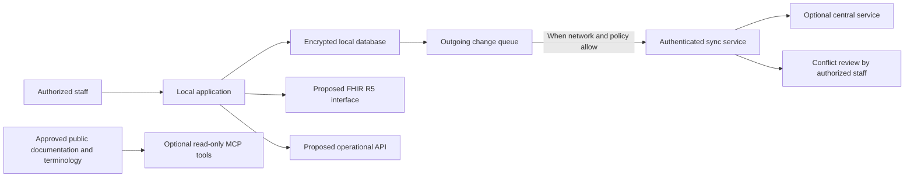

This diagram explains a **proposed design**, not a running service. It shows the boundaries between work at a site, optional synchronization, and future standards-based interfaces.

**Text description:** Staff work in a local application that stores data on the site. Changes wait in a queue until network and policy conditions allow synchronization with an optional central service. A conflict that could change clinical meaning is sent for authorized review. The proposal keeps clinical data exchanges on the FHIR interface, operational functions on a separate API, and any future AI-tool interface limited to approved, non-sensitive documentation or terminology. None of these services or controls is confirmed as implemented.

## What the boundaries mean

- **Local work comes first:** network access is not assumed to be continuously available. This is a design goal that needs usability and failure-recovery tests.
- **Synchronization is a separate operation:** an offline queue is not a backup, and successful delivery must not be assumed until the receiving system acknowledges it.
- **Conflicts need an explicit rule:** the proposal rejects silently replacing one clinical edit with another. A clinical and safety review must define which changes require human review.
- **Interfaces have different jobs:** the blueprint proposes FHIR for clinical exchange and a separate API for operational functions. The exact contracts and supported versions remain undecided.
- **AI-tool access is optional and restricted:** no patient data should be exposed through MCP by default. Any future integration needs a privacy, authorization, threat-model, and clinical-safety review.
- **The diagram does not approve a vendor or deployment:** hosting, identity, encryption-key management, backup destinations, and external partners need separate decisions.

## A reader's offline-to-online walkthrough

1. A staff member records work through the local application. The proposed local store is SQLite; no application using it is confirmed by this documentation.
2. If connectivity is unavailable, the design keeps a pending change locally and tells the user that it has not synchronized.
3. When connectivity returns, the client authenticates to the selected service and submits queued changes using a reviewed protocol.
4. The receiving service validates the request and responds with a result. Failed or incomplete delivery remains visible for retry or support; it is not reported as success.
5. If two users changed the same clinical information, the proposal routes the conflict to a qualified reviewer rather than selecting the newest timestamp automatically.

This sequence is an explanatory target, not an operational instruction. Do not use it to handle real patient data.

## Standards and related pages

- [Organization blueprint](organization-blueprint.md) — proposal status and interface boundaries.
- [Technology baseline snapshot](../reference/technology-baseline.md) — dated version checks and implementation cautions.
- [FHIR R5 specification](https://hl7.org/fhir/R5/) — official clinical data exchange standard.
- [SMART App Launch](https://hl7.org/fhir/smart-app-launch/) — current published guide checked here is based on FHIR R4; compatibility with the proposed R5 interface must be verified.
- [MCP dated specification](https://modelcontextprotocol.io/specification/2026-07-28/) — protocol reference only; not evidence that ZarishHealth has an MCP integration.
