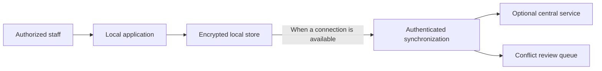

The proposed design is **local-first**: a health site should continue its local work when its internet connection is unavailable. A central service may help sites exchange approved updates, but should not be a required dependency for routine local operation.

## A site working with and without a connection

**Text description:** Authorized staff use the application, which stores work locally. When a connection is available, the site can send and receive authenticated updates. The central service is optional. If edits conflict, the proposed design sends them to a review queue instead of silently choosing a clinical value.

## What the proposal means

- **Work continues locally:** the site's essential workflow should not stop just because its uplink is down.
- **A connection is optional:** synchronization happens when a connection is available; it is not a substitute for local operation.
- **Conflicting clinical edits need review:** the blueprint rejects automatic “latest update wins” for overlapping clinical changes.
- **Patient data must stay out of public documentation:** examples, screenshots, and diagrams use synthetic data.

These are design goals, not verified system behavior. The [organization blueprint](organization-blueprint.md) records the proposal and its open questions.

## Organization repositories

The repository map includes the four repositories currently identified and separates them from repositories proposed for a later phase. The [repository map](repository-map.md) explains that distinction.

## Design status

The organization blueprint is a proposal. The runtime API host, deployment environment, approved data handling, and implementation status require further decisions. Do not use this overview as a deployment or clinical operations guide.

## Further reading

- [Organization blueprint](organization-blueprint.md)
- [Repository map](repository-map.md)
- [Proposed data and integration flow](data-and-integration-flow.md)
- [Technology baseline snapshot](../reference/technology-baseline.md)
- [Glossary](../glossary/index.md)
