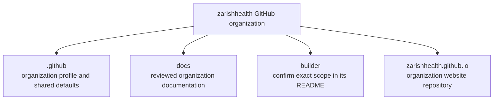

The organization currently has four repositories. The diagram shows the current inventory only; it does not infer ownership or deployment status from a repository name.

**Text description:** The organization has four repositories: `.github`, `docs`, `builder`, and `zarishhealth.github.io`. The `docs` repository holds reviewed documentation. Confirm the precise current role and deployment state of the other repositories in their own README files.

## Current inventory

| Repository | What is confirmed here | What to verify in that repository |
| --- | --- | --- |
| [`.github`](https://github.com/zarishhealth/.github) | Organization-level GitHub repository | Which profiles, community files, or shared workflows are currently active |
| [`docs`](https://github.com/zarishhealth/docs) | This repository; organization guidance and documentation source | Whether the generated site has been approved for publication |
| [`builder`](https://github.com/zarishhealth/builder) | A repository named `builder` exists | Its current purpose, product scope, and release status |
| [`zarishhealth.github.io`](https://github.com/zarishhealth/zarishhealth.github.io) | The organization website repository exists | Whether its website is deployed and which URLs it owns |

## Future repository proposals

The blueprint proposes repositories such as `core`, `app`, `api`, `fhir`, `mcp`, `content`, `deploy`, `distro-template`, and `rfcs`. These names are **not** part of the current four-repository inventory. Create a repository only after its purpose, owner, visibility, data classification, and maintenance cost are reviewed.

## Source of organization-wide rules

See the [organization blueprint](organization-blueprint.md) for proposed repository, directory, file, URL, API, identifier, licensing, and security conventions. If a repository's actual configuration differs, record the difference and ask its maintainers to resolve it rather than assuming the blueprint is already implemented.
