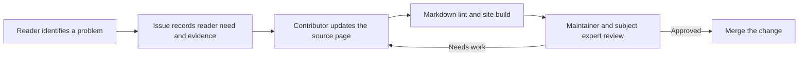

You can suggest an improvement even if you do not write code. A contributor or maintainer can help turn a clear issue into a pull request.

## Before you start

1. Find the page that needs attention and check whether an issue already exists.
2. Identify the reader and the problem the change should solve.
3. Check whether the page describes a proposal, an adopted rule, or verified implementation.
4. Gather reliable sources for factual, technical, or standards-based statements.
5. Use synthetic data only. Do not attach patient records, screenshots containing personal data, credentials, or private deployment information.

## Suggest a change

Open an issue using the **Improve existing documentation** form. Include the page link, the confusing or incorrect passage, the intended reader, the desired outcome, and sources. If you are unsure, describe the problem rather than trying to invent a technical answer.

## Make a change

1. Create a branch using a lowercase type and short kebab-case description, such as `docs/clarify-offline-sync`.
2. Edit the Markdown file under `content/`, or propose a reusable template under `resources/templates/`.
3. Keep one canonical explanation. Link to it rather than duplicating details in several pages.
4. Update the page's `last_reviewed` date and source links when you change factual guidance.
5. Add a diagram only when it helps explain the information. Include the same information in nearby prose.
6. Run the checks below and review the rendered site locally.
7. Open a pull request with the reason for the change, pages affected, source evidence, and any unresolved questions.



**Text description:** A reader or contributor describes a documentation need, then a contributor updates the source page. Automated checks catch formatting and link problems. A maintainer reviews accuracy and either approves the change or asks for revisions.

## Run the checks

Requirements: Node.js 24 or later and npm.

```bash
npm ci
npm run lint:md
npm run build
```

The build fails when local documentation links are broken. A successful build does not verify that an external standard is current or that a design has been implemented.

## Review checklist

- [ ] The page has one clear audience and purpose.
- [ ] The content distinguishes proposals from adopted or implemented behavior.
- [ ] Technical and standards-based statements link to authoritative sources.
- [ ] The prose is plain, concise, and understandable without relying on a diagram.
- [ ] Examples contain only synthetic data and no credentials.
- [ ] The page metadata and links are current.
- [ ] Markdown lint and the site build pass.

## Further reading

- [Content model](../reference/content-model.md)
- [Naming rules](../reference/naming.md)
- [Writing templates](https://github.com/zarishhealth/docs/tree/main/resources/templates)
